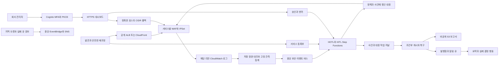

# 구조와 데이터 흐름

회사 AWS 계정 안에 배포되는 제어 영역입니다. 업무 서비스는 회사가 배포하며, 이 저장소는 취약 웹사이트·업무 컨테이너·EC2 서버를 생성하지 않습니다. 서비스 발견은 공개 ALB와 활성 CloudFront에 한정합니다.

## 발견과 연결

기본 태그 opt-in과 제외 태그를 적용합니다. 서비스 ID 태그가 없으면 리소스 ARN에서 안정적인 ID를 생성합니다. 동일 ID가 다른 보호 리소스에 연결되거나 관리 namespace가 충돌하면 중단합니다. 하나의 보호 리소스는 한 설치가 관리하도록 하고, 환경·계정의 관리 책임을 분리합니다.

기존 WAF 규칙·우선순위·default action·가시성과 로깅을 보존합니다. 공유 ACL·Firewall Manager 소유·WAF Classic·기존 S3/Firehose sink·subscription 충돌·불완전한 목록은 변경 전에 검토 대상으로 남깁니다. WAF LockToken과 CloudFront ETag를 확인하며 변경 전 스냅샷은 비공개 감사 버킷에 보관합니다.

생성·태그 변경 이벤트와 주기적 재조정을 조합합니다. 생성 API 이벤트에는 회사의 활성 CloudTrail trail이 필요합니다. 이벤트 미수신 계정도 설정한 리전의 주기적 발견을 사용할 수 있습니다. CloudTrail/GuardDuty 보안 분석 adapter는 기본 파이프라인에 포함되지 않습니다.

## 사건과 조치

수집은 등록된 정확한 로그 그룹·stream·event ID·시각·본문 해시를 실제 저장 로그와 대조합니다. 서비스·IP·규칙·정책 revision별로 중복을 제외한 관측을 집계하고 시간당 사건 생성 한도와 관측 건수를 분리합니다. 소스 writer의 IAM 신뢰 경계는 [보안 경계](security-boundaries.md)에서 다룹니다.

HOTL은 검토한 자동 차단 정책, 최신 관측 저널, Tier·추천 행동·계정·서비스·정책 revision·WAF 연결을 대조합니다. HITL은 관리자 결정과 승인 callback의 확정 상태를 확인합니다. 플랫폼과 사건의 dry run, 서비스의 observe/enforce를 함께 적용하며 입력의 성공 문자열이나 AI 추천만으로 조치를 만들지 않습니다.

최종 사실은 사건·실제 SFN 실행·영구 대응 작업 저널에서 읽습니다. 미확인·실패·부분 적용·모의 실행은 성공과 구분합니다. 보고서 게시·버스 전달이 실패하면 조건부 작업과 sparse index 재조정으로 복구합니다. Slack 영수증과 revision은 재전달의 중복·오래된 메시지 덮어쓰기를 제어합니다.

롤백은 인증된 관리자가 사건의 `service_id`로 찾은 영구 IPSet에서 정확한 `/32` 또는 `/128`만 제거합니다. 클라이언트는 해제 IP·IPSet ARN·계정을 지정할 수 없습니다. 다른 주소·넓은 CIDR·임시 차단 set·응답 작업 tombstone은 보존합니다.

## Terraform 배포 모듈

기본 인프라는 Terraform의 native AWS provider 리소스입니다. `aws_cloudformation_stack`이나 apply 중 Python 설치기 실행으로 배포하지 않습니다. 개발용 `tools/terraform_codegen.py`가 검토된 모델에서 정적 `.tf.json` 모듈을 생성하며, 회사의 배포 시점에는 생성기 Python이 필요하지 않습니다.

| 모듈 | 역할 |
|---|---|
| `terraform/` | 회사 입력·계정 guard·릴리스 아티팩트·모듈 연결·배포 출력·S3 state backend |
| `terraform/modules/foundation/` | 비공개 데이터·키·버스·발견·Cognito·HTTPS 대시보드 |
| `terraform/modules/ingress/` | 보호 리전과 CloudFront용 `us-east-1` 수집·실패 큐·지역 경보 |
| `terraform/modules/governance/` | HOTL/HITL SFN·승인·대응·게시·Slack·복구·중앙 운영 경보 |
| `terraform/bootstrap-state/` | 선택적인 회사 state용 private S3·KMS 준비 |

Terraform은 제어 영역 인프라·함수 환경과 IAM 연결을 소유합니다. 실제 서비스별 WAF 규칙·IPSet 주소·ACL 연결·로그 구독·등록부 및 사건/감사 데이터는 검증된 런타임이 소유합니다. 두 주체가 동일 목록을 전체 덮어쓰지 않도록 유지합니다. 회사 설정·물리 이름 이관 자료·state·plan·배포 출력은 제품 소스와 분리합니다.

첫 설치는 자동 연결 OFF·observe·dry run으로 배포하고 출력의 실제 리소스·인증·아티팩트를 인수합니다. 이후 회사가 자동 연결 변수를 명시적으로 활성화합니다. Terraform apply가 업무 reconcile이나 관리자 초대를 자동 호출하지 않으며, 즉시 재조정은 별도 운영 명령입니다.

## legacy CloudFormation 모듈

| 모듈 | 역할 |
|---|---|
| `infrastructure/foundation.template.json` | 등록·사건·세션·리스·작업·영수증 테이블, KMS/S3, 보안 버스·운영 SNS, 발견 함수, Cognito·HTTP API 대시보드 |
| `infrastructure/security-log-ingress.template.json` | 보호 리전과 CloudFront용 `us-east-1`의 로그 수집·실패 큐·지역 경보 릴레이 |
| `infrastructure/control_plane.template.json` | HOTL/HITL SFN, 승인·대응·terminal·게시·알림·복구·운영 경보 |
| `infrastructure/regional-waf.template.json` | 별도 소유 Regional WAF 모듈. 업무 ALB를 직접 생성·교체하지 않음 |
| `infrastructure/cloudfront-waf.template.json` | `us-east-1` CloudFront WAF 모듈. 업무 Distribution을 직접 생성·교체하지 않음 |

위 템플릿과 `install.py`는 기존 설치 호환·개발 모델 검증을 위해 유지합니다. 새 Terraform 기본 경로와 한 리소스를 동시에 관리하지 않습니다. 사건·감사·보고서·아티팩트는 회사 계정에 남으며, 백업·삭제 보호·이관은 [운영](operations.md)에 설명합니다.
